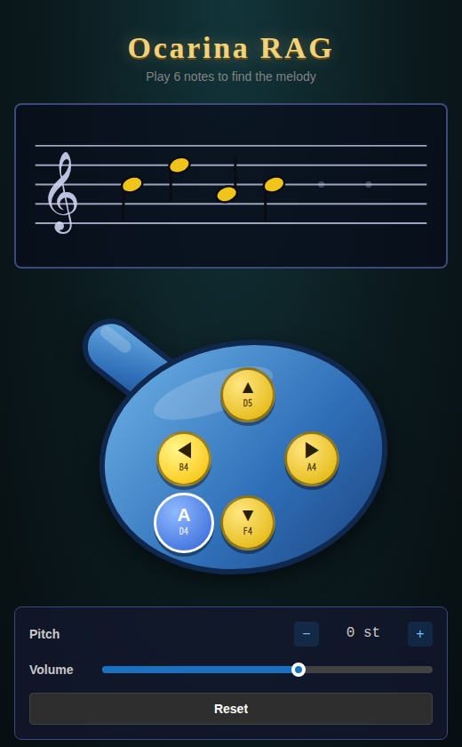
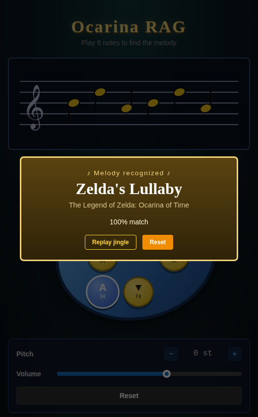

# Ocarina RAG

A Zelda-inspired melody search engine. Play a 6-note snippet on an *Ocarina of Time*-style pad and the app finds the matching song, whether it's a classic Zelda tune or a pop-culture easter egg.

<p align="center">
  
  &nbsp;
  
</p>

> **Unofficial fan project.** Not affiliated with or endorsed by Nintendo, or any of the music acts. *The Legend of Zelda* and *Ocarina of Time* are Nintendo's. The melodies are short, approximate transcriptions made for demonstration.

## How it works

Matching is two-tier:

1. **Recall:** the snippet is converted to semitone intervals and searched in Qdrant (Manhattan distance), so a song still matches when played in a different key.
2. **Re-rank:** a small penalty scaled by how far the played pitch is from the song's original pitch makes exact-key plays score highest.

The "RAG" in the name is used loosely: Currently, this is vector retrieval plus re-ranking, with no generation step.

See [PLAN.md](PLAN.md) for the full design.

## How to play

- Press the five ocarina buttons (A, C-Up, C-Down, C-Left, C-Right). A note sounds while you hold the button.
- The notes appear on the music staff. After the **6th note** the snippet is submitted automatically.
- **Pitch** (+/−) transposes the whole ocarina by semitones, like in the game. It changes the sound and adds a small penalty, but the song still matches.
- **Recognized** (confidence ≥ 90%): a pop-up shows the song, plays its jingle, and offers **Replay jingle** and **Reset**.
- **Close but not quite** (below 90%): the closest songs are listed with their interval similarity and pitch penalty.
- **No match:** the notes fall off the staff and the input resets by itself.

Try the game's own songs, for example Zelda's Lullaby: C-Left, C-Up, C-Right, C-Left, C-Up, C-Right.

> **Accuracy notes:** the note sequences of the Zelda songs are the real ones. Their jingle rhythms are by-ear approximations (Zelda's Lullaby's 3/4 rhythm is the most reliable). The two easter eggs are rough approximations squeezed onto the ocarina's five pitches. All of it lives in [`backend/app/seed.py`](backend/app/seed.py) if you want to tune it.

## Requirements

Only **Docker** with the Compose plugin. Nothing else to install: Python, Node and all dependencies run inside containers.

## Run

```bash
docker compose up --build
```

| Service | URL |
|---|---|
| App (frontend + `/api` proxy) | http://localhost:8080 |
| Backend (FastAPI, docs at `/docs`) | http://localhost:8000 |
| Qdrant | http://localhost:6333/dashboard |

On startup the backend seeds the song database (SQLite) and the vector index (Qdrant). Seeding is idempotent, so restarting is safe. Stop with `docker compose down`; add `-v` to also wipe the stored data.

## Unit tests

```bash
docker compose run --rm --build backend-test    # pytest
docker compose run --rm --build frontend-test   # vitest + Testing Library
```

Each builds a test image from the same locked dependencies and runs inside it. Neither needs the stack running, and neither starts with `docker compose up`.

## End-to-end tests

The E2E tests run against an already-running stack, so start it first:

```bash
docker compose up -d --build
docker compose --profile e2e run --rm --build e2e
docker compose down   # when you're done
```

The tests run in a separate container (a Playwright image with Chromium) and go through nginx like a real user: API tests over HTTP (`e2e/tests/backend/`) plus real-browser UI tests (`e2e/tests/frontend/`). The first run downloads the Playwright base image (~2 GB). If the stack isn't up, they wait up to 60 s, then stop with a message telling you to run `docker compose up`. Nothing to install.

## Tech stack

Python 3.12 · FastAPI · Qdrant · SQLite/SQLAlchemy · React + TypeScript + Vite + Mantine · nginx · Docker Compose

Dependencies are pinned in `backend/uv.lock`, `e2e/uv.lock` and `frontend/package-lock.json`, and the Docker builds install strictly from them (`uv sync --frozen`, `npm ci`). The Qdrant image is pinned too (`v1.19.1`).

## Development notes

To change backend dependencies, edit `backend/pyproject.toml` and regenerate the lock with `uv lock` (needs [uv](https://docs.astral.sh/uv/)). For the frontend, run `npm install` in `frontend/`. Neither is needed just to run or test the project.

## License

[MIT](LICENSE)
